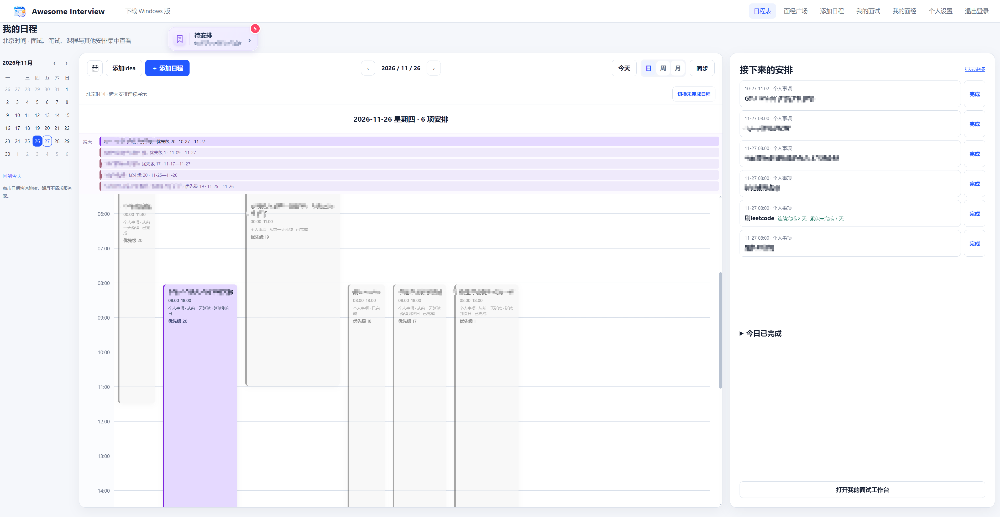
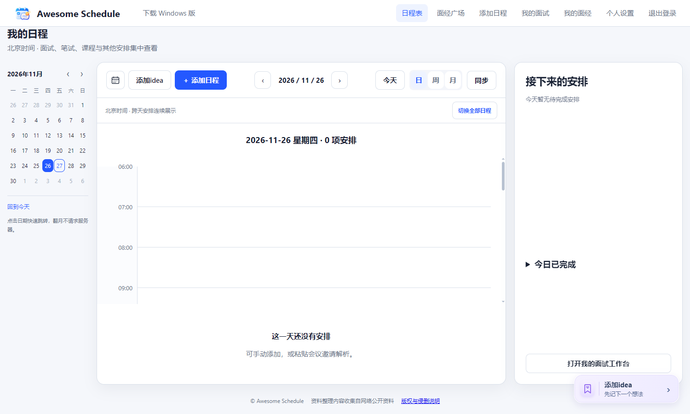

# Awesome Schedule

**一个开源的个人日程工作台。** 把工作、学习和求职安排放进同一张日历，记下还没定时间的想法，按优先级处理今天的事。遇到面试，还可以在这里读简历、记录追问和复盘。

[在线日程表](https://schedule.hunaochufang.xyz/my-schedule) · [面经广场](https://schedule.hunaochufang.xyz/my-schedule/experiences/plaza) · [下载 Windows 版](https://schedule.hunaochufang.xyz/download/windows) · [提交记录](https://github.com/a-big-fish/awesome-schedule/commits/main/)

Awesome Schedule is a self-hosted calendar and task organizer with offline-friendly scheduling, an idea inbox, and tools for interview notes and resume review. It has a Web app and native Android and Windows clients.

可从 `main` 分支获取源码。游客可先试用示例日程或浏览面经广场列表，登录后进入自己的日程表。

## 日程与待安排

- **安排和查看**　在日、周、月间切换，用左侧小日历跳到指定日期。日视图并排显示重叠事项，周、月视图连续展示跨天任务。支持重复日程、工作时段、跳过周末、完成与恢复。可以手动录入，也可以粘贴会议邀请，核对解析结果和时间冲突后保存。
- **长按拖动优先级**　在日视图长按日程卡片约 0.8 秒，再左右拖动。重叠时，高优先级靠近时间栏并使用更醒目的样式。优先级为 1–20，同分的卡片也可以调整左右顺序。编辑卡片中的滑块同样可以设置优先级。
- **拖动「待安排」浮窗**　还没定时间的事项先用「添加 idea」记下来。浮窗有事项时显示数量和首条预览，空时直接提供录入入口。拖动浮窗可换位置，浏览器会记住摆放位置，从浮窗打开事项后也可以选定时间，把它变成日程。
- **先改本机，后台同步**　Web 把日程和待安排保存在 IndexedDB。已有缓存时可以本地翻日历，常用修改先更新界面，再借助待同步队列提交。断线时已缓存的内容仍可使用，恢复连接后继续同步。



<details>
<summary>查看待安排浮窗的空状态</summary>



</details>

## 面试、面经与简历

- **我的面试**　集中查看面试安排、入会链接和当前 PDF 简历，给一场面试关联对应的面经。
- **面经整理**　可逐题记录、粘贴全文或导入 Markdown、文字层 PDF。保留多级追问、现场回答和复盘答案，支持预览及导出 Markdown 或 PDF。选择公开的记录可在面经广场按公司浏览。
- **Web 简历助手**　「练一练」围绕上传的简历提问，可参考个人面经里的相关题目。「简历优化」在原文旁给改写建议并定位 PDF 页码，支持自定义模型、最多双模型流式对照和查看分析历史。日程和面经的常用功能无需配置模型。 [模型与运维说明](app/README.md)

## 客户端

| 客户端 | 可用范围 |
| --- | --- |
| Web | FastAPI、Jinja2 和浏览器本地缓存。个人日程为主要入口，自建本地模式也提供企业会议日程。 |
| Android | 原生测试版，提供日程、待办、面经、面试和简历。模拟器已验证加密离线队列和待办断线重连，系统提醒待真机验收。 [Android 构建说明](android/README.md) |
| Windows | WPF 原生预览，含桌面托盘和外观可调的随身日程。下载页现提供 Preview 31 的 ZIP，应用内更新已接入 Velopack，正式签名包和迁移验收待完成。 [Windows 使用与发布说明](windows/README.md) |

## 开发进展

### 已完成

- **日历与日程编辑**　日、周、月视图支持跨天展示、重叠并排和快速跳日。已接入邀请解析、参考资料、个人工作时段、跳过周末、重复任务，以及完成、恢复和逾期处理。
- **优先级与待安排**　日程可设置 1–20 级优先级，日视图支持长按调整优先级和同级顺序。待安排浮窗可拖动并记住位置，idea 可直接排入日历。
- **本地读取与后台同步**　Web 日历和待安排从 IndexedDB 读取已有数据，修改先显示，再由队列提交。增加幂等回执、失败退回和断线恢复。数据库暂时不可用时，网页可打开并继续使用已有缓存。Web、服务端和原生客户端用共享样例检查日视图行为。
- **面试与面经**　面试列表支持搜索、筛选和分页。面经支持多级追问、全文解析、文件导入和 Markdown／PDF 导出，公开面经可按公司浏览。
- **简历助手**　基于上传的简历练习和改写，建议可定位到原文页。支持添加自定义模型、两个模型并排流式输出，以及回看分析历史。流式回答中途截断时保留已经验证的建议。
- **Android 与 Windows**　Android 主要业务页面已原生化，日程、待安排和待办使用加密队列，已在模拟器验证待办断线重连。Windows 提供托盘、可调外观的随身日程、网页下载和 Velopack 更新入口，当前可下载 Preview 31。
- **性能排查**　增加按页面和客户端区分的请求监测，记录简历助手首条建议的耗时。面经列表在一次查询中读取摘要、题目数和总数。

### 待完成

- **跨设备日程同步**　评估独立资源的增量拉取与删除同步，明确多设备同时修改的处理方式，再逐步移除旧接口。
- **网页多端适配**　用 Tailwind 整理现有样式，保持视觉一致，并验证桌面、平板和手机布局。
- **游客日程与面经复习**　允许游客先保存自己的日程，登录后合并；补充逐题 AI 复习和记忆卡片。
- **模拟面试与复盘**　按企业、岗位和轮次归纳面经中的考察重点和追问方式，附来源和样本；用于简历优化及模拟面试，并补齐会后复盘与评分。
- **原生客户端发布验收**　Android 待验证真机提醒、锁屏、重启和 Doze。Windows 待发布签名 EXE，并验证从 ZIP 预览版迁移、重启后恢复数据和自动更新。

## 自建 Web

服务端需要 Python 3.10+ 和 [uv](https://docs.astral.sh/uv/)。在仓库根目录运行。

```bash
cp .env.example .env
uv sync
uv run uvicorn app.main:app --reload --host 127.0.0.1 --port 8291
```

PowerShell 使用 `Copy-Item .env.example .env`。打开 [本机日程表](http://127.0.0.1:8291/my-schedule)。示例配置使用 `APP_MODE=local` 与 `STORAGE_BACKEND=memory`，重启会清除内存记录。需要持久化时使用 PostgreSQL，也可以配合 RustFS 或 MinIO 保存简历等文件。

要部署多用户个人站点，设置 `APP_MODE=public_personal`、持久化存储和 HTTPS `PUBLIC_BASE_URL`。通过 `REGISTRATION_MODE` 配置注册方式，按需启用邀请码、邮箱验证与 SMTP。开发服务器仅用于本地调试。

## 开发

`app/` 是 Web 服务、页面和 API，`android/` 与 `windows/` 分别是原生客户端工程。`tests/` 包含 Web、接口和跨端契约测试。

```bash
uv run pytest -q
node --test tests/js/*.test.cjs
```

`.env`、运行数据、日志、签名材料和真实简历留在本机。项目代码采用 [MIT License](LICENSE)，第三方资源保留各自的版权与许可证。
